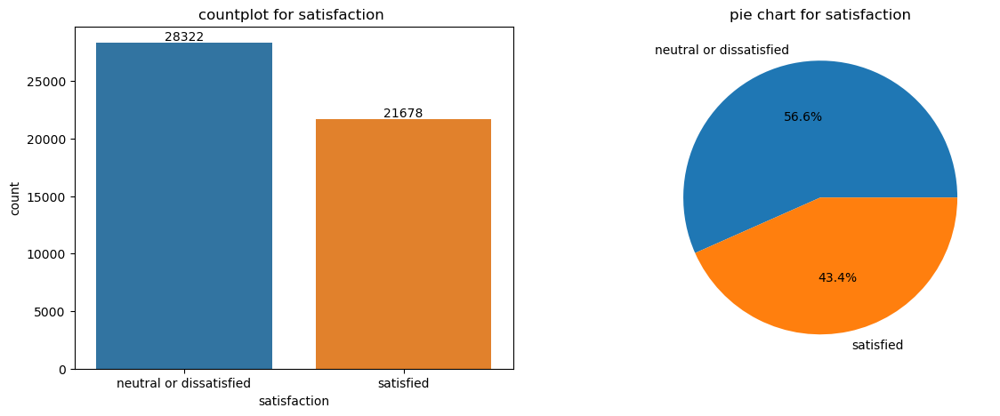
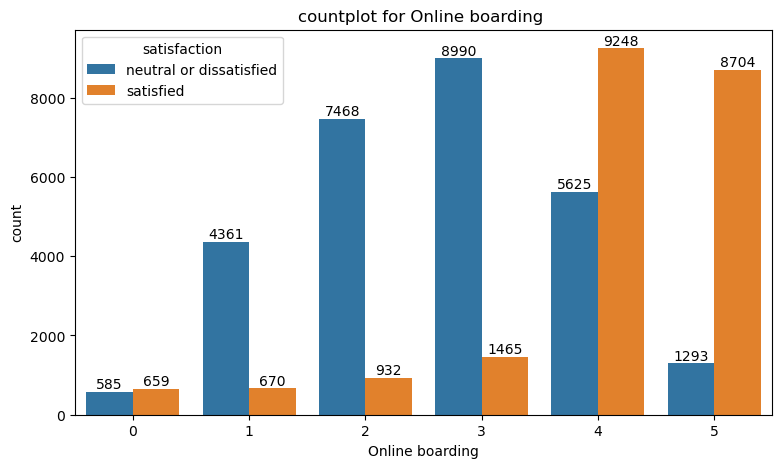
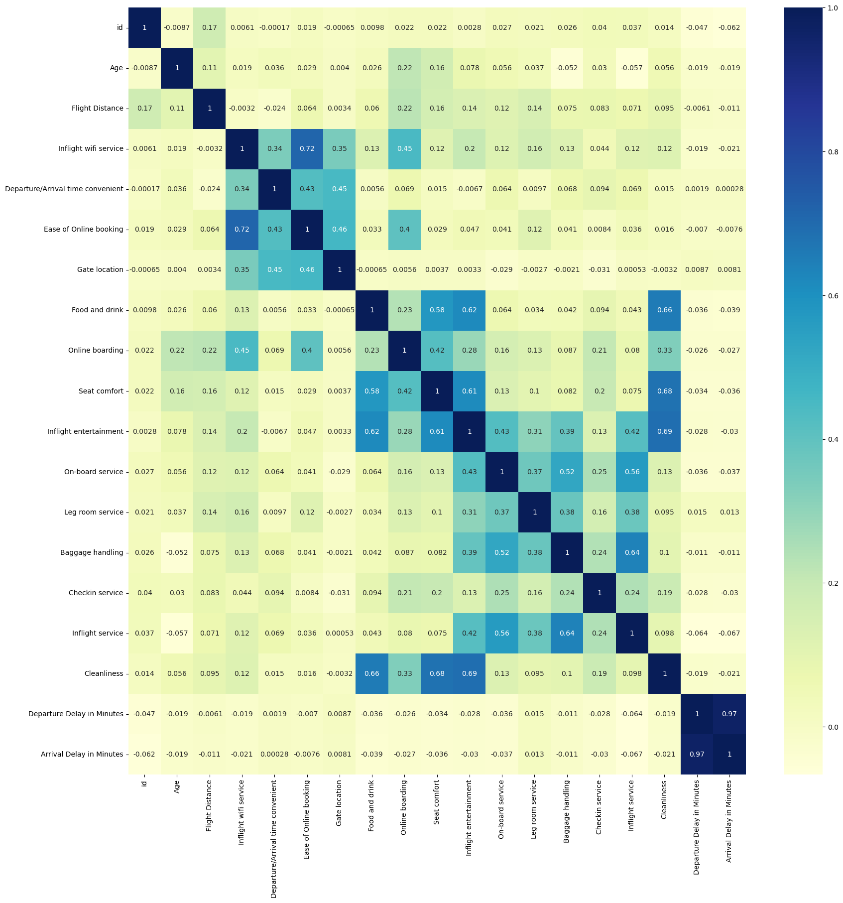
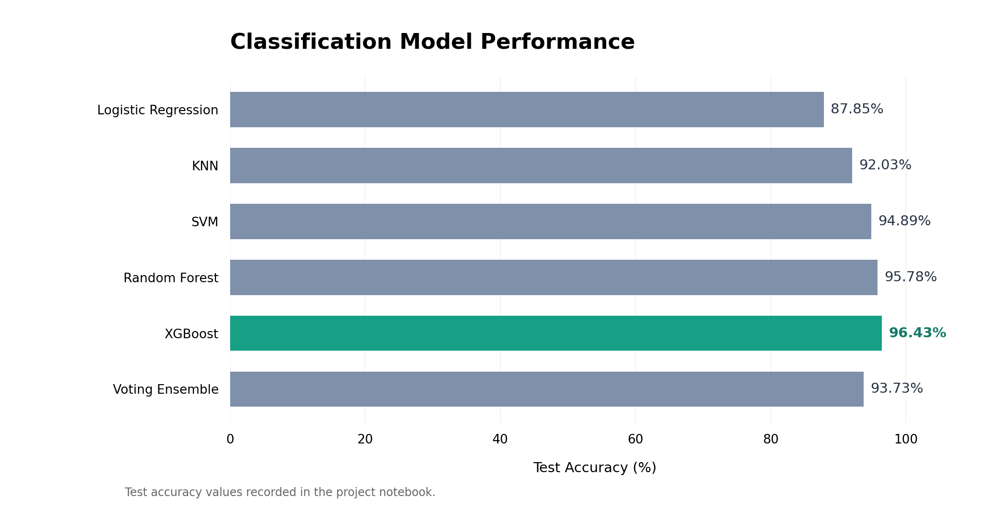
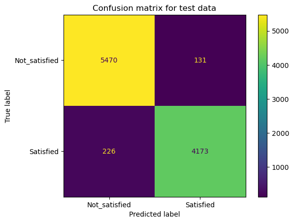

# Airline Customer Satisfaction Prediction

Python machine learning project focused on **passenger satisfaction classification**, exploratory data analysis, service-quality assessment, and comparative model evaluation.

**Python · Pandas · NumPy · Seaborn · Matplotlib · Scikit-learn · XGBoost**

## Project Overview

This project analyzes airline passenger survey data to predict whether a passenger is **Satisfied** or **Neutral / Dissatisfied**. The analysis explores customer demographics, travel characteristics, onboard services, and flight delays before training and evaluating multiple classification algorithms.

The dataset contains **50,000 passenger records and 24 columns**, including the target variable `satisfaction`.

## Business Questions

The project is designed to explore questions such as:

- How can passenger satisfaction be predicted from service and travel characteristics?
- How do customer type, travel class, and flight characteristics relate to satisfaction?
- What patterns emerge across inflight services, comfort, and airport experiences?
- How do flight delays relate to passenger satisfaction?
- Which classification model delivers the highest test accuracy in this experiment?

## Exploratory Data Analysis

The notebook includes dataset profiling, missing-value analysis, categorical comparisons, feature distributions, and correlation analysis. Selected visuals from the notebook are shown below.

### Passenger Satisfaction Distribution

*Distribution of satisfaction categories in the analyzed passenger records.*

### Online Boarding and Passenger Satisfaction

*Exploring how online boarding ratings vary across satisfaction categories.*

### Feature Correlations

*Correlation structure of the numerical and encoded features used in the analysis.*

## Machine Learning Workflow

1. **Data preparation:** Impute missing arrival-delay values using the dataset median and encode categorical features using `LabelEncoder`.
2. **Dataset splitting:** Create training, validation, and test subsets.
3. **Feature scaling:** Apply `StandardScaler` to the individual classifier experiments.
4. **Model training:** Train Logistic Regression, K-Nearest Neighbors, Support Vector Machine, Random Forest, and XGBoost classifiers.
5. **Model evaluation:** Compare accuracy scores and examine classification reports and confusion matrices.
6. **Ensemble learning:** Evaluate a soft-voting classifier combining Logistic Regression, KNN, SVM, Random Forest, and Gradient Boosting on a separate train/test split.

## Model Performance

Test accuracy values recorded in the Jupyter notebook:

| Classification Model | Test Accuracy |
| --- | ---: |
| Logistic Regression | 87.85% |
| K-Nearest Neighbors (KNN) | 92.03% |
| Support Vector Machine (SVM) | 94.89% |
| Random Forest | 95.78% |
| **XGBoost** | **96.43%** |
| Soft Voting Ensemble | 93.73% |

*Model comparison based on saved notebook outputs. XGBoost has the highest recorded test accuracy (96.43%).*

### XGBoost Classification Results

*Confusion matrix saved in the notebook for the XGBoost classifier.*

**Evaluation note:** These figures reflect the notebook's saved experiment outputs and have not been independently reproduced in a fresh environment. The soft-voting experiment uses a separate train/test split, so its result is not a strictly controlled like-for-like comparison with every individual classifier.

## Dataset

The source dataset includes passenger demographics, travel details, airline service ratings, departure and arrival delays, and a binary satisfaction label.

**Dataset dimensions:** 50,000 rows × 24 columns

**Target:** `satisfaction` — Satisfied / Neutral or Dissatisfied

Examples of input features:

- Gender, Age, Customer Type, Type of Travel, Class
- Flight Distance
- Inflight Wi-Fi Service, Online Boarding, Seat Comfort
- Inflight Entertainment, On-board Service, Leg Room Service
- Baggage Handling, Check-in Service, Cleanliness
- Departure Delay and Arrival Delay in Minutes

## Tools & Technologies

- **Python** — data analysis and model development
- **Pandas & NumPy** — data manipulation
- **Matplotlib & Seaborn** — exploratory visualization
- **Scikit-learn** — preprocessing, classification, and evaluation
- **XGBoost** — gradient-boosted classification
- **Jupyter Notebook** — interactive experimentation

## Project Files

- [`notebooks/Airline_Customer_Satisfaction.ipynb`](notebooks/Airline_Customer_Satisfaction.ipynb) — exploratory analysis, preprocessing, model training, and evaluation
- [`data/airplane services.csv`](data/airplane%20services.csv) — source passenger satisfaction dataset
- [`images/`](images/) — selected exploratory analysis and model evaluation figures

## Author

**Omar Ali**  
Data Engineering · Analytics Engineering

[LinkedIn](https://www.linkedin.com/in/eng-omargomaa) · [GitHub](https://github.com/omaraligomaa)
